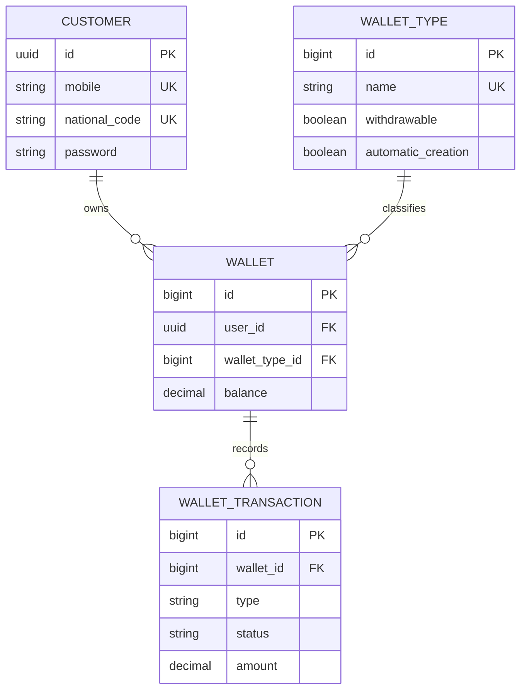

# Customer Wallet API

## 1. Project overview

Customer Wallet is a Django backend for customer accounts, wallet balances, and transaction history. Customers register, log in with a mobile number and password, and use a JWT to access their wallets and request balance increases or decreases.

The project focuses on three problems: identifying the customer making a request, updating money safely when requests arrive simultaneously, and blocking repeated requests within a short time window.

**Opening statement for the presentation:**

> “This project provides a wallet API with JWT authentication, database constraints for money validation, PostgreSQL row locks for concurrent updates, and Redis to block repeated transaction requests.”

## 2. Technology stack

| Component | Role |
|---|---|
| Python and Django | Models, validation, HTTP endpoints, and database transactions |
| PostgreSQL | Customer, wallet, and transaction storage; constraints and row locks |
| Redis | Temporary reservations that block repeated wallet operations |
| PyJWT | Signing and verifying one-hour access tokens |
| Django password hashers | Password hashing and verification |
| fakeredis with Lua support | Testing Redis behavior without a running Redis server |

The API uses Django views, forms, and `JsonResponse` directly.

## 3. Application structure

```text
customer-wallet/
├── config/                 # Settings and project URL routing
├── customers/
│   ├── models.py           # Customer model and creation manager
│   ├── forms.py            # Registration validation
│   ├── views.py            # Registration and login
│   └── tokens.py           # JWT generation, verification, and authentication decorator
├── wallets/
│   ├── models.py           # Wallet and WalletTransaction
│   ├── forms.py            # Transaction type and amount validation
│   ├── decorators.py       # Request validation and Redis duplicate protection
│   ├── services.py         # Balance update rules and database transaction
│   ├── views.py            # Wallet listing and transaction endpoint
│   └── urls.py             # Wallet routes
├── requirements.txt        # Runtime dependencies
├── requirements-dev.txt    # Runtime dependencies plus Redis testing tools
└── manage.py
```

Views handle HTTP requests and responses. Decorators handle authentication, validation, and duplicate protection. The service contains balance-changing logic. Models define persistent data and database constraints.

## 4. Data model



### Customer — `customers`

- UUID primary key.
- Required mobile, national code, and hashed password.
- Mobile and national code are unique.
- Optional username, email, first name, last name, and birthdate. Username is unique when supplied.
- Automatic creation and update timestamps.

Customer accounts use a separate model from Django's built-in admin users. Registration currently accepts mobile, national code, and password; the other fields are available on the model.

### Wallet — `wallets`

- Auto-incrementing integer primary key.
- Required customer foreign key, stored as `user_id`.
- Required wallet-type foreign key and a balance that defaults to `0.00`.
- Automatic creation and update timestamps.

One customer can own multiple wallets, with at most one wallet for each type. A database unique constraint enforces this. Transactions specify the wallet type ID, and the authenticated customer determines which wallet is used.

### Wallet type — `wallet_types`

Each type has an integer ID, unique name, timestamps, a `withdrawable` flag, and an `automatic_creation` flag. The seeded `personal` type enables both flags. A missing wallet is created on demand when automatic creation is enabled; otherwise the transaction returns 404. An unknown type also returns 404. Withdrawals from a non-withdrawable type return 403. Existing wallets remain usable when automatic creation is disabled.

Balances use `DecimalField(max_digits=20, decimal_places=2)` to represent amounts with two decimal places. A database check constraint enforces `balance >= 0`, including when application validation is bypassed.

### Wallet transaction — `wallet_transactions`

- Auto-incrementing integer primary key and required wallet foreign key.
- Type: `INCREASED` or `DECREASED`.
- Status: `PENDING`, `COMPLETED`, or `FAILED`.
- Positive decimal amount and automatic timestamps.

The database enforces valid types, valid statuses, and `amount > 0`. Although the model defaults to `PENDING`, the synchronous transaction endpoint creates records directly as `COMPLETED` or `FAILED`.

`PROTECT` prevents deleting a customer with wallets or a wallet with transaction history.

## 5. API endpoints

| Method | Endpoint | Authentication | Purpose |
|---|---|---|---|
| POST | `/api/customers/register/` | Public | Register using mobile, national code, and password |
| POST | `/api/customers/login/` | Public | Verify mobile and password; return an access token |
| GET | `/api/wallets/` | Bearer JWT | List the authenticated customer's wallets |
| POST | `/api/wallets/types/<wallet_type_id>/transactions/` | Bearer JWT | Increase or decrease a wallet balance |

Wallets are created on demand during transactions for types with automatic creation enabled. Profile updates and transaction-history listing do not yet have public endpoints.

## 6. Authentication and ownership

Registration validates input and password strength. Passwords are hashed before storage. Login verifies the supplied password against the stored hash.

Successful login returns:

```json
{
  "access_token": "<signed-token>",
  "token_type": "Bearer",
  "expires_in": 3600
}
```

The token is signed with HS256 and contains `userId`, creation time (`iat`), and expiry (`exp`). Protected requests send it in the `Authorization: Bearer <token>` header.

The authentication decorator verifies the signature, required claims, expiry, and customer existence, then sets `request.customer`. Wallet queries use this customer to enforce ownership. A wallet belonging to someone else returns the same 404 response as a missing wallet.

## 7. How a balance change works

1. Verify the Bearer token and identify the customer.
2. Validate the JSON body, transaction type, and positive decimal amount.
3. Atomically reserve a Redis key for the customer, wallet type, and transaction type.
4. Enter `transaction.atomic()`, lock the customer row, check type permissions, and resolve or create the wallet. Lock the wallet using `select_for_update()`.
5. Check that this request still owns the Redis reservation.
6. Calculate the proposed balance and check for insufficient funds or overflow.
7. Create a transaction record and, if successful, update the balance.
8. Check reservation ownership again before committing.
9. Mark the Redis operation as completed for three minutes and return the response.

`transaction.atomic()` makes the balance change and transaction record commit together. An exception rolls back database changes inside the block.

The wallet row lock prevents two operations from reading the same old balance and independently spending it. Another operation on that wallet waits until the first database transaction ends.

**Example:** A wallet holds `100.00`. Two withdrawals of `75.00` cannot both succeed through the service. After the first commits, the second sees `25.00` and fails. The Redis decorator may reject an immediate duplicate even earlier.

Insufficient funds returns HTTP 400, leaves the balance unchanged, and creates a `FAILED` transaction. This is a handled business outcome, so the failed record is committed.

## 8. Redis duplicate-request protection

The server generates the key; clients do not need an `Idempotency-Key` header:

```text
wallet-type-operation:<customer_id>:<wallet_type_id>:<transaction_type>
```

| State | Expiry | Behavior |
|---|---|---|
| `IN_PROGRESS:<unique-owner>` | 120 seconds | A request has reserved the operation |
| `COMPLETED` | 180 seconds from completion | The operation was recently processed |
| Key absent | — | A new request may reserve it |

Redis `SET ... NX EX 120` combines checking and reserving into one atomic command. A duplicate receives HTTP 409 without another balance change. Lua scripts compare the owner value before replacing or deleting a key, preventing an older request from modifying a newer reservation.

The key excludes the amount. Consequently, a second request for the same customer, wallet, and type is blocked even when its amount differs. Different wallets and transaction types have separate keys.

A handled insufficient-funds response also starts the three-minute completed window. A missing wallet releases the reservation. Unexpected exceptions leave it to expire. If Redis is unavailable before processing, the endpoint returns 503. If Redis finalization fails after the database commit, the actual transaction response is preserved and the cache failure is logged.

**Scope of the guarantee:** This is duplicate suppression within a time window. After expiry, an identical request can run again. Redis eviction or restart can also remove protection. PostgreSQL and Redis do not share one atomic commit, so the design does not guarantee permanent exactly-once execution. Reservation checks reduce expiry-related risks but cannot remove the gap between the final check and database commit.

## 9. Demonstration

Start PostgreSQL and Redis, configure `.env`, install dependencies, and apply migrations:

```bash
pip install -r requirements.txt
python manage.py migrate
python manage.py runserver
```

Required database settings are `DB_NAME`, `DB_USER`, `DB_PASSWORD`, `DB_HOST`, and `DB_PORT`. Configure `REDIS_URL`, for example `redis://127.0.0.1:6379/0`, and a private `JWT_SIGNING_KEY`.

### Register and log in

```bash
curl -i -X POST http://127.0.0.1:8000/api/customers/register/ \
  -H 'Content-Type: application/json' \
  -d '{"mobile":"09123456789","national_code":"0012345678","password":"Strong-customer-pass-72!"}'

curl -i -X POST http://127.0.0.1:8000/api/customers/login/ \
  -H 'Content-Type: application/json' \
  -d '{"mobile":"09123456789","password":"Strong-customer-pass-72!"}'
```

Use a fresh mobile and national code if the demonstration customer already exists.

### Find the personal wallet type

After applying migrations, run `python manage.py shell` in another terminal:

```python
from wallets.models import WalletType

personal = WalletType.objects.get(name='personal')
print(personal.pk)
```

Use that type ID in place of `1` below. Copy the token from login. The first
INCREASED request automatically creates the customer's personal wallet.

```bash
curl -i http://127.0.0.1:8000/api/wallets/ \
  -H 'Authorization: Bearer YOUR_ACCESS_TOKEN'

curl -i -X POST http://127.0.0.1:8000/api/wallets/types/1/transactions/ \
  -H 'Authorization: Bearer YOUR_ACCESS_TOKEN' \
  -H 'Content-Type: application/json' \
  -d '{"type":"INCREASED","amount":"100.00"}'

curl -i -X POST http://127.0.0.1:8000/api/wallets/types/1/transactions/ \
  -H 'Authorization: Bearer YOUR_ACCESS_TOKEN' \
  -H 'Content-Type: application/json' \
  -d '{"type":"DECREASED","amount":"25.00"}'
```

Show the resulting balance of `75.00`. Repeat the withdrawal immediately to demonstrate HTTP 409 and an unchanged balance. To demonstrate insufficient funds on the same wallet, wait until its DECREASED key expires before requesting an amount greater than the balance.

## 10. Testing and current boundaries

Tests cover registration, password hashing, JWT validation, wallet ownership, model constraints, successful and failed transactions, rollback behavior, Redis expiry, concurrent duplicate reservations, and ownership-safe Lua updates.

```bash
pip install -r requirements-dev.txt
python manage.py test wallets customers
```

Redis tests use fakeredis with Lua support. PostgreSQL concurrency tests require a PostgreSQL test database and are skipped on SQLite. Local verification so far used SQLite and fakeredis; real PostgreSQL concurrency remains unverified in this session.

Balance increases currently modify the internal balance directly. There is no payment-provider confirmation or external payout integration, and a decrease is not a transfer to another customer's wallet. Those integrations and their authorization rules would be separate work.

## 11. Closing presentation statement

> “The API separates authentication, validation, transaction processing, and storage. Database constraints protect the data, row locks coordinate concurrent balance changes, and Redis blocks repeated requests for a short period. The current implementation demonstrates these backend mechanisms while keeping external payments and permanent exactly-once processing outside its scope.”

## Wallet-type migration

Migration 0005 maps existing type names to WalletType records while preserving
wallet IDs, balances, and transaction history. Personal enables automatic
creation; other migrated types disable it by default. All migrated types allow
withdrawals to preserve existing behavior.

If duplicate wallets exist for a customer and type, the migration stops for
manual reconciliation rather than merging funds or history. The migration is
intentionally irreversible because it replaces the text type with a foreign key.
The old wallet-ID transaction route is replaced by the explicit type-ID route.
Wallet listing returns wallet_type_id, wallet_type_name, and withdrawable.
A first withdrawal on an automatically created wallet records insufficient
funds and leaves that wallet at zero balance.
