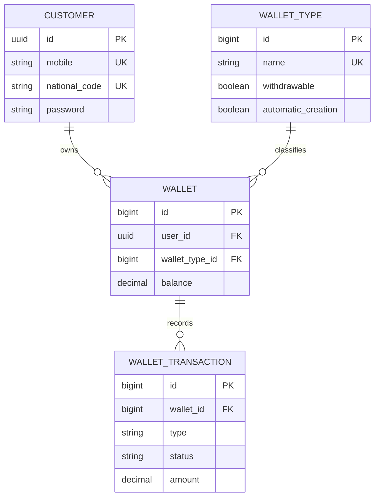

# Customer Wallet API

## 1. Project overview

Customer Wallet is a Django backend for customer accounts, wallet balances, and transaction history. Customers register, log in with a mobile number and password, and use a JWT to access their wallets and request balance increases or decreases.

The project combines configurable wallet types with automatic wallet creation. Each customer can have one wallet per type. It also addresses customer authentication, safe concurrent balance updates, and repeated transaction requests.

**Opening statement for the presentation:**

> “This project provides a wallet API with JWT authentication, database constraints for money validation, PostgreSQL row locks for concurrent updates, and Redis to block repeated transaction requests.”

## 2. Technology stack

| Component | Role |
|---|---|
| Python and Django | Models, validation, HTTP endpoints, and database transactions |
| PostgreSQL | Customer, wallet type, wallet, and transaction storage; constraints and row locks |
| Redis | Temporary reservations that block repeated wallet operations |
| PyJWT | Signing and verifying one-hour access tokens |
| Django password hashers | Password hashing and verification |
| fakeredis with Lua support | Testing Redis behavior without a running Redis server |

The API uses Django views, forms, and `JsonResponse` directly.

## 3. Application structure

```text
customer-wallet/
├── config/                 # Settings and project URL routing
├── customers/
│   ├── models.py           # Customer model and creation manager
│   ├── forms.py            # Registration validation
│   ├── views.py            # Registration and login
│   ├── tokens.py           # JWT generation, verification, and authentication decorator
│   └── tests/              # Model, registration, and login tests
├── wallets/
│   ├── models.py           # WalletType, Wallet, WalletTransaction, and WalletOperation
│   ├── forms.py            # Transaction type and amount validation
│   ├── decorators.py       # Request validation and Redis duplicate protection
│   ├── services.py         # Balance update rules and database transaction
│   ├── views.py            # Wallet listing and transaction endpoint
│   ├── urls.py             # Wallet routes
│   └── tests/              # Models, listing, types, transactions, history, and Redis tests
├── requirements.txt        # Runtime dependencies
├── requirements-dev.txt    # Runtime dependencies plus Redis testing tools
└── manage.py
```

Views handle HTTP requests and responses. Decorators handle authentication, validation, and duplicate protection. The service contains balance-changing logic. Models define persistent data and database constraints.

## 4. Data model



### Customer — `customers`

- UUID primary key.
- Required mobile, national code, and hashed password.
- Mobile and national code are unique.
- Optional username, email, first name, last name, and birthdate. Username is unique when supplied.
- Automatic creation and update timestamps.

Customer accounts use a separate model from Django's built-in admin users. Registration currently accepts mobile, national code, and password; the other fields are available on the model.

### Wallet — `wallets`

- Auto-incrementing integer primary key.
- Required customer foreign key, stored as `user_id`.
- Required wallet-type foreign key and a balance that defaults to `0.00`.
- Automatic creation and update timestamps.

One customer can own multiple wallets, with at most one wallet for each type. A database unique constraint enforces this. Transactions specify the wallet type ID, and the authenticated customer determines which wallet is used.

Balances use `DecimalField(max_digits=20, decimal_places=2)` to represent amounts with two decimal places. A database check constraint enforces `balance >= 0`, including when application validation is bypassed.

### Wallet type — `wallet_types`

Each type has an integer ID, unique name, timestamps, a `withdrawable` flag, and an `automatic_creation` flag. The seeded `personal` type enables both flags. A missing wallet is created on demand when automatic creation is enabled; otherwise the transaction returns 404. An unknown type also returns 404. Withdrawals from a non-withdrawable type return 403. Existing wallets remain usable when automatic creation is disabled.


### Wallet transaction — `wallet_transactions`

- Auto-incrementing integer primary key and required wallet foreign key.
- Type: `INCREASED` or `DECREASED`.
- Status: `PENDING`, `COMPLETED`, or `FAILED`.
- Positive decimal amount and automatic timestamps.

The database enforces valid types, valid statuses, and `amount > 0`. Although the model defaults to `PENDING`, the synchronous transaction endpoint creates records directly as `COMPLETED` or `FAILED`.

`PROTECT` prevents deleting a customer with wallets, a wallet type used by wallets, or a wallet with transaction history.

## 5. API endpoints

| Method | Endpoint | Authentication | Purpose |
|---|---|---|---|
| POST | `/api/customers/register/` | Public | Register using mobile, national code, and password |
| POST | `/api/customers/login/` | Public | Verify mobile and password; return an access token |
| GET | `/api/wallets/` | Bearer JWT | List the authenticated customer's wallets |
| GET | `/api/wallets/transactions/?wallet_type_id=<id>` | Bearer JWT | Transaction history, optionally filtered by wallet type |
| POST | `/api/wallets/types/<wallet_type_id>/transactions/` | Bearer JWT | Increase or decrease a wallet balance |

Wallets are created on demand during transactions for types with automatic creation enabled. Profile updates do not yet have a public endpoint.

### Wallet type versus transaction type

| Value | Meaning | Example |
|---|---|---|
| `wallet_type_id` in the URL | The configured category of wallet | The ID of `personal` |
| `type` in the JSON body | The direction of the balance change | `INCREASED` or `DECREASED` |
| `wallet_id` in the response | The resolved or newly created wallet | A specific customer's wallet ID |

Registration does not create wallets. `GET /api/wallets/` lists existing wallets and does not create them either. Creation happens during an eligible transaction request.

### Business rules

| Situation | Result |
|---|---|
| Type ID does not exist | 404; no wallet created |
| DECREASED and `withdrawable=False` | 403; no wallet created or balance changed |
| Wallet missing and `automatic_creation=False` | 404; no wallet created |
| Wallet missing and `automatic_creation=True` | Create at zero, then process the operation |
| Existing wallet and `automatic_creation=False` | Process normally, subject to withdrawal permission |
| Amount exceeds available balance | 400; record FAILED; balance unchanged |
| First operation is a permitted withdrawal | Create at zero if allowed, then record insufficient funds |
| Same request ID still processing | 409; retry later with the same ID |
| Same request ID already completed | Replay original status and body |
| Same request ID with changed details | 409 conflict |

## 6. Authentication and ownership

Registration validates input and password strength. Passwords are hashed before storage. Login verifies the supplied password against the stored hash.

Successful login returns:

```json
{
  "access_token": "<signed-token>",
  "token_type": "Bearer",
  "expires_in": 3600
}
```

The token is signed with HS256 and contains `userId`, creation time (`iat`), and expiry (`exp`). Protected requests send it in the `Authorization: Bearer <token>` header.

The authentication decorator verifies the signature, required claims, expiry, and customer existence, then sets `request.customer`. Wallet queries use this customer to enforce ownership. The client supplies a shared wallet type ID, not another customer’s wallet ID. The server resolves the pair `(authenticated customer, wallet type)` and only reads or changes that customer’s wallet.

## 7. How a balance change works

1. Verify the Bearer token and identify the customer.
2. Validate the JSON body, transaction type, and positive decimal amount.
3. Require a frontend request UUID, replay a saved result if present, or reserve a Redis key for the customer and request ID.
4. Enter `transaction.atomic()`, lock the customer row, and check again for a completed operation. For a new operation, check type permissions, resolve or create the wallet, and lock it.
5. Check that this request still owns the Redis reservation.
6. Calculate the proposed balance and check for insufficient funds or overflow.
7. Create a transaction record and, if successful, update the balance.
8. Check reservation ownership again and save the operation details and result in the same database transaction.
9. Mark the Redis operation as completed for three minutes and return the response.

`transaction.atomic()` makes the balance change and transaction record commit together. An exception rolls back database changes inside the block.

The customer row lock serializes wallet creation and balance operations for the same customer, including requests with different transaction types. Together with the unique `(user, wallet_type)` constraint, it prevents two concurrent requests from creating duplicate wallets. Different customers can proceed independently.

The wallet row lock prevents two operations from reading the same old balance and independently spending it. Another operation on that wallet waits until the first database transaction ends.

**Example:** A wallet holds `100.00`. Two withdrawals of `75.00` cannot both succeed through the service. After the first commits, the second sees `25.00` and fails. The Redis decorator may reject an immediate duplicate even earlier.

Insufficient funds returns HTTP 400, leaves the balance unchanged, and creates a `FAILED` transaction. This is a handled business outcome, so the failed record is committed.

## 8. Request IDs, durable idempotency, and Redis

The frontend generates a UUID once for each intended operation and sends it as:

```http
Idempotency-Key: 6a8105ea-852b-4ae3-87a0-7f7bac757fcb
```

A retry must reuse the same ID. A new withdrawal or increase must use a new ID,
even if its amount is identical. Missing or invalid IDs return 400 without
changing the balance. IDs are scoped to the authenticated customer.

The server first checks the `wallet_operations` table. A completed request
returns its original response body and HTTP status without updating the wallet
again. Reusing the same ID with a different wallet type, direction, or amount
returns 409. Amounts such as `25` and `25.00` are treated as equivalent.

If no result exists, Redis reserves:

```text
wallet-request:<customer_id>:<request_id>
```

| State | Expiry | Behavior |
|---|---|---|
| `IN_PROGRESS:<unique-owner>` | 120 seconds | Another attempt with this ID receives 409 while processing |
| `COMPLETED` | 180 seconds | The database result takes precedence and is replayed |
| Key absent | — | Check the database before permitting a new attempt |

Redis uses atomic SET NX EX and owner-checked Lua updates. The database service
locks the customer, checks the request ID again, and commits the operation
record, wallet change, and transaction record together. A unique constraint
on `(user, request_id)` enforces one operation record per customer and ID.
The repeated check under the lock prevents duplicate changes even if two
requests acquire Redis reservations at different times after expiry.

`WalletOperation` stores the request ID, customer, normalized request details,
response body, HTTP status, creation timestamp, and an optional link to its
wallet transaction. It also stores handled failures, including insufficient
funds, disabled withdrawals, and missing wallet/type responses. Retrying a
failed request returns that original failure; starting a new attempt requires
a new ID. Invalid JSON, invalid fields, and authentication failures are not
stored as operations.

New requests return 503 if Redis is unavailable before processing. Previously
completed requests can be replayed without Redis. Redis finalization failures
after a commit do not discard the saved result. Database operation records do
not expire automatically and must be retained to preserve retry protection.
This guarantee applies to the internal database changes; external payment
providers would require their own coordinated idempotency.

**Two-device example:** Different request IDs represent separate operations,
and database locks prevent overdrafts. A shared request ID represents one
operation and replays one result. The server cannot infer that two different
IDs represent the same intention.

## 9. Demonstration

Start PostgreSQL and Redis, configure `.env`, install dependencies, and apply migrations:

```bash
pip install -r requirements.txt
python manage.py migrate
python manage.py runserver
```

Required database settings are `DB_NAME`, `DB_USER`, `DB_PASSWORD`, `DB_HOST`, and `DB_PORT`. Configure `REDIS_URL`, for example `redis://127.0.0.1:6379/0`, and a private `JWT_SIGNING_KEY`.

### Register and log in

```bash
curl -i -X POST http://127.0.0.1:8000/api/customers/register/ \
  -H 'Content-Type: application/json' \
  -d '{"mobile":"09123456789","national_code":"0012345678","password":"Strong-customer-pass-72!"}'

curl -i -X POST http://127.0.0.1:8000/api/customers/login/ \
  -H 'Content-Type: application/json' \
  -d '{"mobile":"09123456789","password":"Strong-customer-pass-72!"}'
```

Use a fresh mobile and national code if the demonstration customer already exists.

### Find the personal wallet type

After applying migrations, run `python manage.py shell` in another terminal:

```python
from wallets.models import WalletType

personal = WalletType.objects.get(name='personal')
print(personal.pk)
```

Use that type ID in place of `1` below. Copy the token from login. The first
INCREASED request automatically creates the customer's personal wallet.

```bash
curl -i http://127.0.0.1:8000/api/wallets/ \
  -H 'Authorization: Bearer YOUR_ACCESS_TOKEN'

curl -i -X POST http://127.0.0.1:8000/api/wallets/types/1/transactions/ \
  -H 'Authorization: Bearer YOUR_ACCESS_TOKEN' \
  -H 'Content-Type: application/json' \
  -H 'Idempotency-Key: 6a8105ea-852b-4ae3-87a0-7f7bac757fcb' \
  -d '{"type":"INCREASED","amount":"100.00"}'

curl -i -X POST http://127.0.0.1:8000/api/wallets/types/1/transactions/ \
  -H 'Authorization: Bearer YOUR_ACCESS_TOKEN' \
  -H 'Content-Type: application/json' \
  -H 'Idempotency-Key: dc46d026-6e37-4b49-a99a-f2cf99f58e9f' \
  -d '{"type":"DECREASED","amount":"25.00"}'
```

The first wallet list for a newly registered customer returns `{"wallets": []}`. The first increase creates the personal wallet and credits `100.00`.

A successful withdrawal returns a response shaped like this (IDs and timestamps vary):

```json
{
  "transaction_id": 2,
  "wallet_id": 7,
  "wallet_type_id": 1,
  "type": "DECREASED",
  "status": "COMPLETED",
  "amount": "25.00",
  "balance": "75.00",
  "created_at": "2026-11-07T10:00:00+00:00"
}
```

List wallets again to show `wallet_type_id`, `wallet_type_name`, `withdrawable`, and the resulting balance of `75.00`. Repeat the withdrawal with the same Idempotency-Key to demonstrate the original 201 response and unchanged balance. Use a fresh UUID to demonstrate a new withdrawal immediately. Use another fresh UUID and an amount greater than the balance to demonstrate insufficient funds.

## 10. Testing and current boundaries

Tests cover registration, password hashing, JWT validation, wallet ownership, one-wallet-per-type uniqueness, automatic creation, withdrawal permissions, successful and failed transactions, rollback behavior, Redis expiry, concurrent duplicate reservations, and ownership-safe Lua updates. PostgreSQL-specific tests cover concurrent wallet creation and withdrawals.

```bash
pip install -r requirements-dev.txt
# All tests (Django discovers each app's tests package)
python manage.py test

# All wallet tests
python manage.py test wallets

# One module
python manage.py test wallets.tests.test_transactions

# Redis tests
python manage.py test wallets.tests.test_redis_idempotency
```

Redis tests use fakeredis with Lua support. PostgreSQL concurrency tests require a PostgreSQL test database and are skipped on SQLite. Local verification so far used SQLite and fakeredis; real PostgreSQL concurrency remains unverified in this session.

Balance increases currently modify the internal balance directly. There is no payment-provider confirmation or external payout integration, and a decrease is not a transfer to another customer's wallet. Those integrations and their authorization rules would be separate work.

## 11. Migrating existing wallets

Migration 0005 maps existing type names to WalletType records while preserving
wallet IDs, balances, and transaction history. Personal enables automatic
creation; other migrated types disable it by default. All migrated types allow
withdrawals to preserve existing behavior.

If duplicate wallets exist for a customer and type, the migration stops for
manual reconciliation rather than merging funds or history. The migration is
intentionally irreversible because it replaces the text type with a foreign key.
The old wallet-ID transaction route is replaced by the explicit type-ID route.
Wallet listing returns wallet_type_id, wallet_type_name, and withdrawable.
A first withdrawal on an automatically created wallet records insufficient
funds and leaves that wallet at zero balance.

## 12. Closing presentation statement

> “Wallet types define creation and withdrawal rules, while each customer owns at most one wallet of each type. The API separates authentication, validation, transaction processing, and storage. Database constraints protect the data, row locks coordinate concurrent balance changes, and Redis coordinates requests in progress, and durable operation records prevent completed retries from changing balances again. The current implementation demonstrates these backend mechanisms while keeping external payments outside its scope.”

Migration 0006 creates wallet_operations for durable request-ID tracking. Apply it before sending requests with Idempotency-Key headers.

## Reading transaction history

```bash
# All of the authenticated customer's wallets, grouped by wallet type
curl http://127.0.0.1:8000/api/wallets/transactions/ \
  -H 'Authorization: Bearer YOUR_ACCESS_TOKEN'

# Only the customer's wallet for the selected type
curl 'http://127.0.0.1:8000/api/wallets/transactions/?wallet_type_id=1' \
  -H 'Authorization: Bearer YOUR_ACCESS_TOKEN'
```

Both responses use a `wallets` array. Each group contains wallet_id,
wallet_type_id, wallet_type_name, and a transactions array. Transactions include
id, type, status, amount, created_at, and updated_at, ordered newest first.
All statuses are included. Existing empty wallets have an empty transactions
array. If the customer has no wallet of the requested type, wallets is empty;
reading history never creates wallets. Invalid type IDs return 400.

This endpoint returns the full matching history without pagination. Amounts
are decimal strings, and only the JWT customer's wallets are queried.
